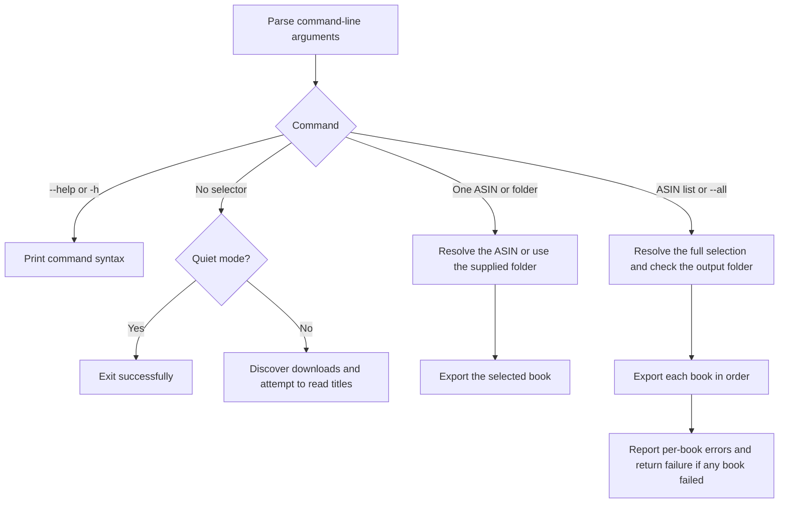
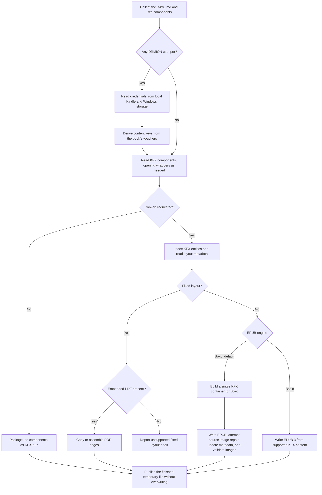

# Kindle-stripper code flow

The diagrams follow the CLI entry point and the export of an individual book. See [How Kindle-stripper works](implementation.md) for the source map and design rationale.

## Command dispatch

Discovery checks for the expected folder and main filename. Listing falls back to the ASIN when metadata is unavailable. A supplied ASIN list must resolve in full before the batch starts.

## Read a book and choose its output

The component-reading node represents work performed as needed by each output path. KFX-ZIP streams unwrapped components into the archive. Conversion builds a shared KFX index, and Boko also reads components into its own multipart adapter. Output writers use a temporary file in the destination directory. If any step fails, the book's export stops before publication. A batch continues with the next book.
