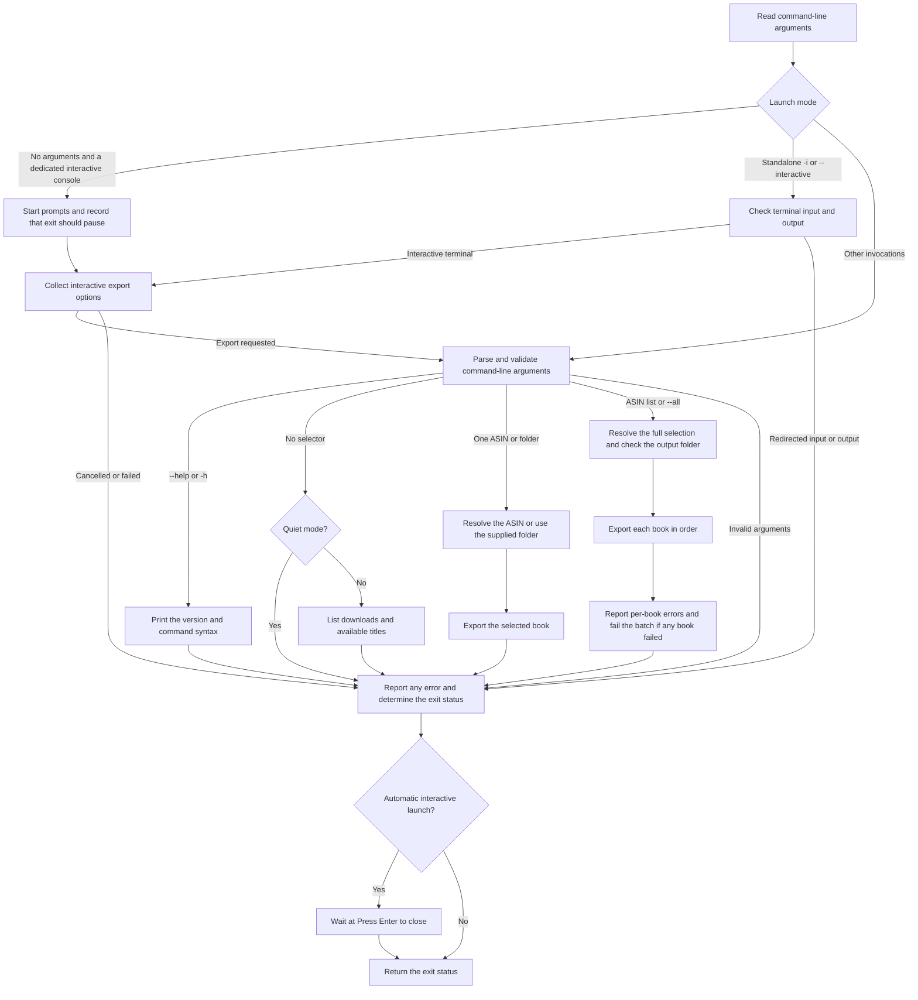
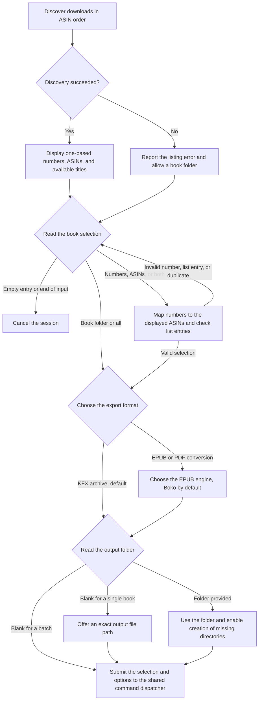
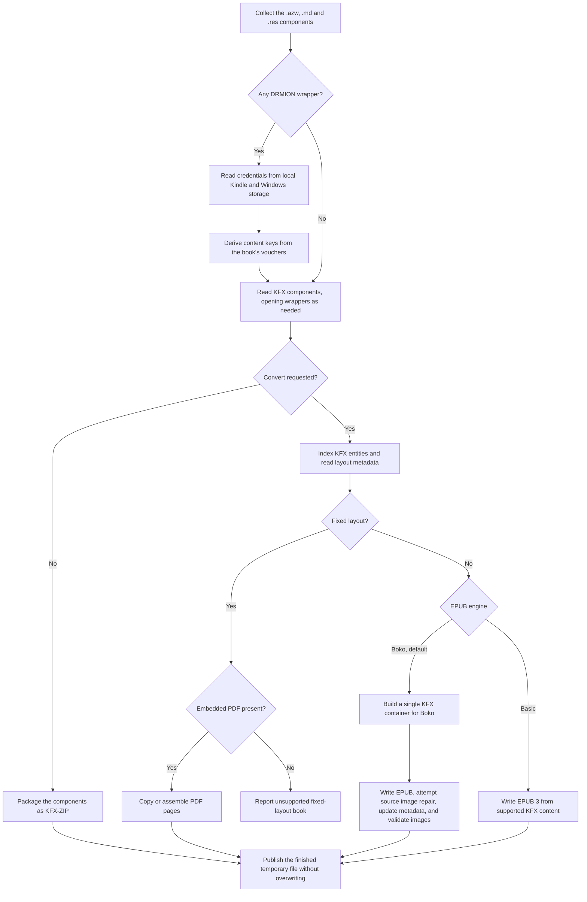
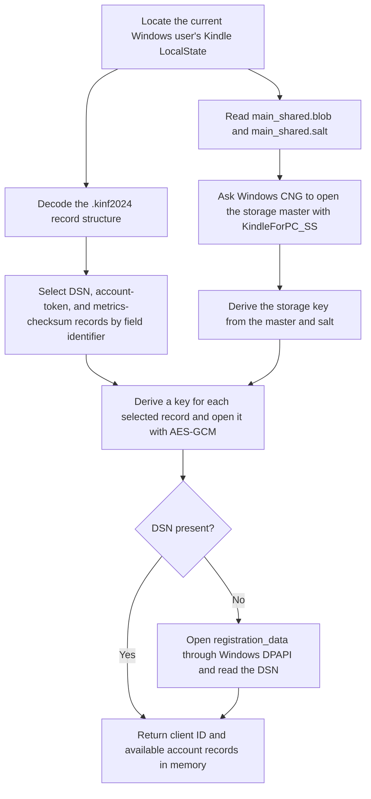
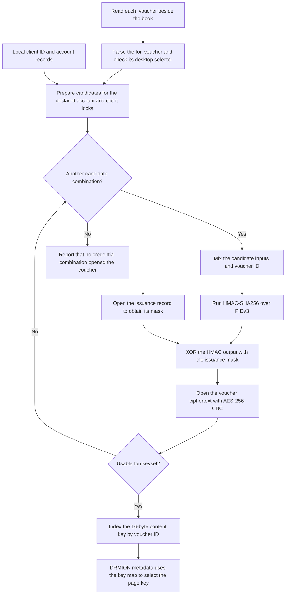

# Kindle-stripper code flow

The diagrams follow the Windows launch, the interactive prompts, and the export of an individual book. See [How Kindle-stripper works](implementation.md) for the source map and design rationale.

## Launch and command dispatch

The automatic route detects a fresh console through terminal input and output and the Windows console process list. This is the usual File Explorer double-click path. A supplied ASIN list must resolve in full before the batch starts.

## Collect interactive export options

Discovery checks for the expected book folder and main filename. Each entry shows its ASIN even if the title is unavailable. The prompts keep the displayed numbering for the session and preserve selection order. The dispatcher validates an interactive folder's nearest existing ancestor before creating missing directories. End of input also cancels the session during later prompts.

## Read a book and choose its output

The component-reading node represents work performed as needed by each output path. KFX-ZIP streams unwrapped components into the archive. Conversion builds a shared KFX index, and Boko also reads components into its own multipart adapter. Output writers use a temporary file in the destination directory. If any step fails, the book's export stops before publication. A batch continues with the next book.

## Read local Kindle credentials

CNG tries the platform provider before the software provider. The private key stays with Windows. AES-GCM checks each selected record's authentication tag. The stage also requires at least one supported account record. See [kindle_store.rs](../src/kindle_store.rs).

## Derive content keys from vouchers

A lock that the voucher does not declare contributes no value. The Ion keyset can carry the content key directly or in an inner wrapped record. Conflicting keys for the same voucher ID stop the export. See [voucher.rs](../src/voucher.rs), [voucher_mixer.rs](../src/voucher_mixer.rs), and [drmion.rs](../src/drmion.rs).
